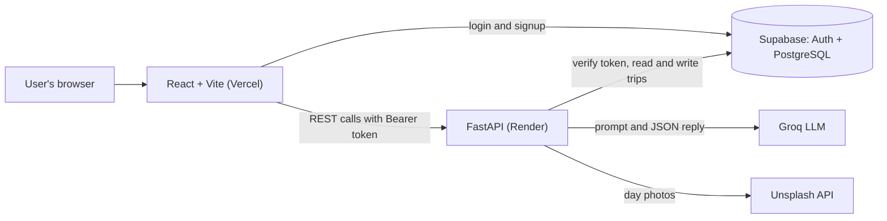

# Architecture

## Overview

- The **frontend** handles the user interface and talks to Supabase directly only for login.
- The **backend** holds all secrets, builds prompts, calls the AI and photo services, and is the
  only code that writes trips to the database.
- **Supabase** stores users, trips and itineraries, and handles passwords and tokens.

## Request flow: creating a trip

1. The user submits the form. React sends `POST /trips` with the Supabase token.
2. `get_current_user_id` asks Supabase to verify the token and returns the user's ID.
3. FastAPI validates the body against `CreateTripRequest` (types, ranges, dates).
4. `build_itinerary_prompt` turns the preferences into instructions: the vibe and pace guides,
   the interests, the budget, dietary and mobility needs.
5. The AI service sends a system prompt (role, rules, exact JSON format) plus that request to Groq
   in JSON mode.
6. The reply is parsed and checked against the `DayItinerary` schema. If it is malformed, the
   request is retried once.
7. Activities in each day are sorted by start time, and each day's cost is recalculated.
8. The image service adds one Unsplash photo per day (failures are ignored).
9. The trip and the itinerary (version 1) are saved, an entry is written to `history`, and the
   result is returned.

The trip is saved **after** the AI succeeds, so a failed AI call leaves no empty trips behind.

## Backend layout

| Path | Responsibility |
|---|---|
| `app/main.py` | App creation, CORS, error handler, health endpoint |
| `app/config.py` | Settings read from environment variables (Pydantic Settings) |
| `app/routes/trips.py` | The HTTP endpoints |
| `app/schemas/schemas.py` | Request and response models, and validation rules |
| `app/prompts/templates.py` | System prompt, vibe and pace guides, prompt builders |
| `app/services/ai.py` | `LLMProvider` interface, `GroqProvider`, validation and retry |
| `app/services/trip.py` | Database operations for trips and itineraries |
| `app/services/images.py` | Unsplash search with in-memory caching |
| `app/services/history.py` | Activity log |
| `app/utils/auth.py` | Token verification |
| `app/utils/db.py` | Supabase client |
| `app/utils/errors.py` | Error classes with HTTP status codes |

## Frontend layout

| Path | Responsibility |
|---|---|
| `src/context/AuthContext.jsx` | Shares the logged-in user with every page |
| `src/components/ProtectedRoute.jsx` | Redirects to login when there is no session |
| `src/components/Layout.jsx`, `Sidebar.jsx`, `TopBar.jsx` | The frame around logged-in pages |
| `src/components/EditTripPanel.jsx` | Edit form on the trip page |
| `src/pages/Login.jsx` | Login and signup |
| `src/pages/Dashboard.jsx` | List of trips |
| `src/pages/CreateTrip.jsx` | 3-step form, destination suggestions |
| `src/pages/TripView.jsx` | Itinerary, regenerate, export, delete |
| `src/services/api.js` | One `request` function that adds the token to every call |
| `src/services/supabase.js` | Supabase client (public anon key) |

## Data model

| Table | Used by the app | Notes |
|---|---|---|
| `users` | Yes | Created automatically by a database trigger when someone signs up |
| `trips` | Yes | The details from the form |
| `itineraries` | Yes | One row per version. The plan is stored as JSON in `content` |
| `history` | Yes | Activity log |
| `preferences` | No | Created for future use (saving default preferences) |
| `saved_places` | No | Created for future use (bookmarks) |

Relationships: `trips` belong to a user, and `itineraries` belong to a trip. Deleting a user or
trip cascades to everything under it.

## Key design decisions

- **Supabase Auth instead of custom JWT code.** Passwords, tokens and refresh are handled by a
  tested service. The backend only verifies tokens.
- **Backend uses the service key, so it filters by user itself.** The service key bypasses row
  level security, so every query includes the user's ID. Row level security is also enabled as a
  second layer. A request for someone else's trip returns 404, never 403, so it doesn't reveal
  that the trip exists.
- **Itineraries are versioned.** Regenerating adds a row instead of overwriting, so earlier plans
  are never lost and the AI can be told what changed.
- **AI output is validated, not trusted.** The reply must match the schema, otherwise it is
  retried once and then rejected. Activities are sorted by time and costs are recalculated
  server-side, because language models are unreliable at arithmetic.
- **Provider abstraction.** `LLMProvider` lets another AI service be added without touching the
  routes. The Groq model name is a setting, because Groq retires models (the original Llama 3.3
  model was retired in August 2026).
- **Route grouping is done through the prompt.** The system prompt asks for nearby places on the
  same day, an `area` per activity and travel time between stops, and the UI displays them.
- **Photos are decoration.** One photo per day keeps usage within Unsplash's demo limit, results
  are cached, and any failure is ignored.
- **CORS allow-list.** Only the configured frontend address and localhost can call the API from a
  browser.